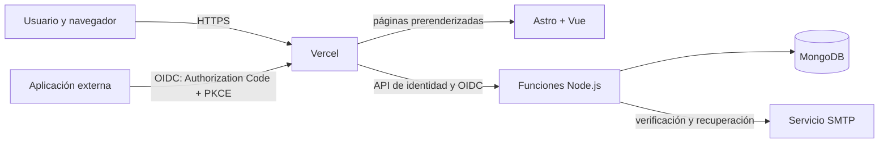

# Arquitectura de Karmancos ID

## Visión general

Karmancos ID es un proveedor central de identidad. Las aplicaciones delegan la autenticación mediante OpenID Connect y reciben tokens OAuth 2.0. No deben recibir ni almacenar la contraseña de Karmancos del usuario.

## Componentes

### Web y API (`web/`)

Astro genera las páginas públicas y empaqueta las rutas API como funciones Node.js de Vercel. La lógica de identidad está en `web/src/server/identity/` y cubre cuentas, sesiones, controles de acceso, clientes OAuth, consentimiento y endpoints OIDC. La configuración de Vercel debe usar `web` como directorio raíz.

### Servicios de datos y correo

MongoDB almacena usuarios, clientes, consentimientos, sesiones, autorizaciones, auditoría, límites de intentos y tokens de acciones. SMTP entrega los enlaces de verificación y recuperación. Ambos son servicios externos a Vercel y sus credenciales se guardan como variables de entorno.

### Backend Java anterior (`backend/`)

La carpeta conserva la implementación Spring Boot usada por el despliegue anterior. Vercel no la construye ni la necesita: el proyecto usa únicamente las rutas Node.js de `web/`.

### SDK del navegador (`sdk/`)

`@karmancosid/web` genera `state`, `nonce` y PKCE S256 por transacción. El modo popup valida el origen, la ventana y el `state` del mensaje de retorno. El SDK valida la firma RS256 del ID token con JWKS y comprueba `iss`, `aud`, `azp`, `nonce`, `sub` y tiempos. Conserva los tokens de la sesión solo en memoria.

## Flujo de acceso OIDC

1. La aplicación crea el cliente con `createKarmancosID()` y llama a `signIn()` desde una acción del usuario.
2. El SDK obtiene el documento de descubrimiento y abre la autorización en una ventana emergente o redirige la ventana actual.
3. Karmancos ID autentica al usuario y solicita consentimiento para los permisos requeridos.
4. El proveedor devuelve un código a una URI de retorno registrada exactamente.
5. La aplicación intercambia el código usando el verificador PKCE. En un cliente web público, el navegador realiza el intercambio desde un origen aprobado.
6. El SDK valida el ID token. La aplicación también debe validar los tokens en su backend cuando los use para autorizar operaciones de servidor.

## Identificadores de sujeto

Los tokens incluyen un `sub` opaco derivado mediante HMAC para reducir la correlación entre sectores de clientes. El correo no se usa como identificador OIDC. El secreto HMAC debe conservarse estable; rotarlo cambia los `sub` calculados.

## Fronteras de confianza

- Las contraseñas se envían únicamente al proveedor de identidad mediante HTTPS.
- Un cliente público no puede mantener un secreto confidencial. PKCE protege el intercambio del código.
- Las URI de retorno se comparan exactamente; los orígenes de navegador se autorizan por separado.
- El navegador no es una frontera de confianza para las reglas de autorización de la aplicación cliente. Cada producto valida los tokens y permisos en su servidor.
- Los secretos de producción, SMTP y claves de firma no pertenecen al repositorio.

## Persistencia y operación

Las funciones reutilizan su conexión MongoDB durante la vida de cada instancia caliente y limitan el tamaño del pool. Alinea la región de Vercel con la de MongoDB y configura índices únicos y TTL. La guía de [despliegue](DEPLOYMENT.md) documenta la inicialización de índices y las variables requeridas.
