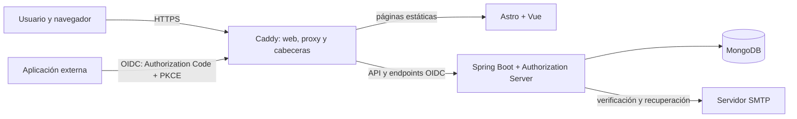

# Arquitectura de Karmancos ID

## Visión general

Karmancos ID es un proveedor central de identidad. Las aplicaciones cliente delegan la autenticación al proveedor mediante OpenID Connect y reciben tokens OAuth 2.0. No deben recibir ni almacenar la contraseña de Karmancos del usuario.

## Componentes

### Web (`web/`)

La interfaz estática se genera con Astro. Vue aporta interacciones para login, registro, cuenta, consentimiento, solicitudes de integración y administración. Caddy sirve los archivos estáticos y reenvía al backend las rutas API y OIDC bajo el mismo origen.

### Backend (`backend/`)

Spring Boot y Spring Security Authorization Server gestionan usuarios, autenticación, emisión de tokens OIDC, consentimiento, clientes y endpoints administrativos. MongoDB almacena cuentas, clientes, autorizaciones, sesiones, auditoría, límites de intentos y tokens de acciones de cuenta.

### SDK del navegador (`sdk/`)

`@karmancosid/web` genera `state`, `nonce` y PKCE S256 por transacción. El modo popup valida el origen, la ventana y el `state` del mensaje de retorno. El SDK valida la firma RS256 del ID token con JWKS y comprueba `iss`, `aud`, `azp`, `nonce`, `sub` y tiempos. Conserva los tokens de la sesión solo en memoria.

## Flujo de acceso OIDC

1. La aplicación crea el cliente con `createKarmancosID()` y llama a `signIn()` desde una acción del usuario.
2. El SDK obtiene el documento de descubrimiento y abre la autorización en una ventana emergente o redirige la ventana actual.
3. Karmancos ID autentica al usuario y pide consentimiento para los scopes solicitados cuando corresponde.
4. El proveedor devuelve un código de autorización a una URI registrada exactamente.
5. La aplicación intercambia el código por tokens usando el verificador PKCE. En un cliente web público, el navegador realiza el intercambio y requiere el origen web aprobado.
6. El SDK valida el ID token. La aplicación debe validar también los tokens en su backend si los usa para autorizar operaciones de servidor.

## Identificadores de sujeto

Los tokens incluyen un `sub` opaco derivado mediante HMAC para reducir la correlación entre sectores de clientes. El correo no se usa como identificador OIDC. El secreto HMAC debe conservarse estable; su rotación sin migración cambia los `sub` calculados.

## Fronteras de confianza

- Las contraseñas se envían únicamente al proveedor de identidad mediante HTTPS.
- Un cliente público no puede mantener un secreto confidencial. PKCE protege el intercambio del código.
- Las URI de retorno se validan y comparan exactamente; los orígenes de navegador se autorizan por separado.
- El navegador no es una frontera de confianza para las reglas de autorización de la aplicación cliente. Valida tokens y permisos en el servidor de cada producto.
- Los secretos de producción, SMTP y las claves de firma no pertenecen al repositorio.

## Persistencia y operación

MongoDB debe tener índices activos para índices únicos y expiración TTL. El endpoint `/api/health` comprueba conectividad y permisos de lectura y escritura necesarios en colecciones del servicio. Usa una base de desarrollo separada de producción para probar.
