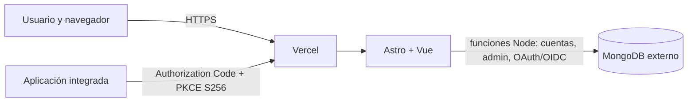

# Arquitectura de Karmancos ID

## Vista general

Vercel aloja la aplicación y ejecuta sus rutas API. MongoDB es un servicio externo de datos. No hay runtime Java, contenedor, servidor local de producción, SMTP ni otro servicio auxiliar en el despliegue.

## Estructura del proyecto

- `web/src/pages/`: rutas de Astro y puntos de entrada HTTP.
- `web/src/components/`: formularios y paneles Vue, con componentes UI y vistas reutilizables.
- `web/src/lib/identity-api.ts`: cliente compartido del navegador, gestión CSRF y errores de API.
- `web/src/server/identity/`: funciones de API agrupadas por autenticación, cuentas, administración, recuperación, MFA y OAuth/OIDC.
- `web/src/server/identity/storage.ts`: conexión MongoDB reutilizada por instancia cálida, colecciones y límites de pool.
- `web/src/server/identity/*-repository.ts`: consultas de usuarios, clientes y consentimientos separadas de las rutas.
- `web/src/server/identity/operations.ts`: auditoría y límites de peticiones.
- `web/src/server/identity/types.ts`: contratos de persistencia y protocolo.
- `web/scripts/create-indexes.mjs`: inicialización repetible de índices, ejecutada como tarea operativa.
- `sdk/`: SDK de navegador. Las rutas OIDC y exportaciones del SDK forman contratos públicos estables.

## Identidad, MFA y recuperación

El registro crea cuentas con `emailVerified: false`. No existe una ruta de envío o comprobación de correo. La cuenta usa contraseña local para entrar a Karmancos ID; OAuth/OIDC permite que otras aplicaciones deleguen acceso.

Las cuentas administradoras deben configurar TOTP antes de entrar al panel. Los secretos TOTP se cifran con AES-256-GCM y la clave `KARMANCOS_MFA_ENCRYPTION_KEY_B64`. Se generan códigos de recuperación de un uso y solo se muestran al activar MFA. Los accesos, consumos de recuperación, cambios de perfil y acciones administrativas relevantes quedan en auditoría.

Si una persona pierde acceso, la administración verifica su identidad fuera del producto, inicia sesión con TOTP y le entrega un código de recuperación de un solo uso, limitado a 30 minutos. Karmancos ID solo guarda el hash del código; la administración nunca consulta ni establece contraseñas. El restablecimiento revoca sesiones y autorizaciones anteriores.

## OAuth 2.0 / OpenID Connect

El proveedor expone Authorization Code, PKCE S256, callbacks exactos, `state`, `nonce`, scopes y subjects pairwise. Los clientes públicos no usan secreto ni reciben refresh token. Los clientes confidenciales deben proteger el secreto en su servidor. El SDK comprueba firma y claims del ID token antes de devolver la identidad.

Los identificadores `sub` no contienen el correo y dependen del HMAC estable. Mantén el issuer, las claves de firma y el HMAC al migrar; cualquier rotación debe planear la continuidad de identidades y tokens.

## Operación

Las funciones reutilizan un pool MongoDB acotado. Alinea la región de Vercel y MongoDB, mide latencia y conexiones desde staging, y confirma copias restaurables, alertas, límites, rotación y reversión antes de publicar. Consulta [despliegue](DEPLOYMENT.md).
